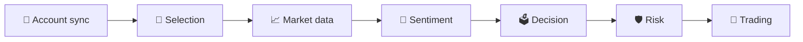

<div align="center">

<h1>
  <picture>
    <source media="(prefers-color-scheme: dark)" srcset="docs/assets/wordmark-dark.svg">
    
  </picture>
</h1>

**A synod of AI agents that deliberates before every trade.**

A multi-agent LLM trading system for Interactive Brokers, built for safety, auditability and plain YAML configuration.

Teams of LLM agents pick stocks, read the crowd, vote on trades and check each other's risk,<br>
while deterministic code holds the money, enforces the hard limits and places the orders.

[](https://github.com/ZackCHZhang/synodtrade/actions/workflows/ci.yml)


[](LICENSE)

**English** | [简体中文](README.zh-CN.md)

[Features](#-features) · [How it works](#-how-it-works) · [Benchmark](#-paper-benchmark) · [Quick start](#-quick-start) · [Web console](#-web-console) · [Configuration](#-configuration) · [Development](#-development) · [License](#-license)

</div>

---

> [!WARNING]
> This is research software, not financial advice. It runs in **paper / dry-run mode by default**: live trading needs both `mode: live` in the pipeline **and** `SYNODTRADE_ALLOW_LIVE=1` in the environment. Use it at your own risk.

## ✨ Features

- 🧠 **Multi-agent at every stage.** Each stage runs several independent agent instances (any mix of models and providers) and aggregates them with weighted votes, scores or medians. No single LLM call decides a trade.
- 🛡️ **Safety outside the model.** A deterministic hard-rule engine (position size, exposure, daily/weekly loss, liquidity, trading hours, kill switch) runs before any risk agent, and risk agents can only *reduce* risk.
- 📜 **Everything is recorded.** Every prompt, response, token count, decision, vote, risk verdict, order and fill lands in the database with stable data ids that agents cite, so you can audit why a trade happened.
- 🧾 **Config as code.** Pipelines, 66 bundled agents, prompts, risk rules, accounts, providers and schedules are plain YAML + Jinja2 under `configs/`, validated with the same Pydantic models the runtime uses.
- 🖥️ **A full web console.** Edit configs visually (with byte-preserving YAML round-trips), launch runs and stream their logs live, run the scheduler, sync accounts and browse every table, in English or Chinese.
- 🔁 **Idempotent, reconciled execution.** Marketable limit orders with idempotent client ids, fill tracking, late-fill correction and per-pipeline virtual sub-ledgers reconciled against the real IBKR account.
- 🗓️ **Exchange-aware scheduling.** Runs anchored to the real exchange calendar (holidays, early closes, DST), with a two-layer guard against double runs and a pre-flight health check.
- 🧪 **Fully offline mode.** `--offline` replaces the broker, market data, sentiment and LLMs with fakes, so the whole pipeline runs end to end with no gateway, no API keys and no network.

## 🧭 How it works



A **pipeline** is an account, a capital budget, a universe and an ordered list of stages. Every stage is optional, and each one can instantiate any number of agents:

| Stage | What it does |
|---|---|
| **Account sync** | Before live paper/live runs: pulls order status, executions, positions and NAV from IBKR so the run starts from the truth. |
| **Selection** | Candidates from a static universe and IBKR market scanners → quantitative screen → selection agents → aggregated top picks, kept on a rolling watchlist. |
| **Market data** | Incremental IBKR historical bars, quote snapshots, account snapshots and SEC EDGAR fundamentals. |
| **Sentiment** | Collects posts and headlines, prefilters them for tokens, and lets sentiment agents summarize mood and extract events. |
| **Decision** | Decision agents see code-computed indicators, recent bars, sentiment and their own past decisions, then vote; votes are aggregated into one action. |
| **Risk** | Hard rules first, then risk agents that can only downgrade; combined by most-conservative or median. |
| **Trading** | Converts actions into sized orders using five-tier sizing, places them idempotently, and tracks them to fill or cancel. |

Under the hood it is a Python monorepo of small Poetry packages with a strictly enforced dependency graph:

```
core ← database ← {market_data, selection, sentiment, decision, risk, trading} ← account_sync ← pipeline ← scheduler ← webapi
```

Business packages never import each other. They cooperate through protocols in `synodtrade_core.interfaces`, and the pipeline injects the implementations ([import-linter](https://github.com/seddonym/import-linter) checks this in CI).

## 📊 Paper benchmark

SynodTrade publishes its own track record. Every pipeline that trades an IBKR paper account gets a daily equity curve built from its real paper fills, measured against its benchmark (SPY by default), together with the LLM models it runs on and what its LLM calls cost. `poetry run synodtrade benchmark` regenerates the [`benchmark/`](benchmark/README.md) folder (pages, chart and raw data) and the summary below.

**Model arena.** `configs/pipelines/arena_*.yaml` run the very same pipeline (selection, sentiment, a 5-agent decision vote and 3 risk agents) once per LLM, each with its own 100k virtual sub-ledger on one IBKR paper account. They differ only in `default_model` (and their IBKR client ids), which a test enforces, so the benchmark compares models and nothing else: DeepSeek, Qwen, GLM, GPT and Claude through [OpenRouter](https://openrouter.ai), all low-cost models. `arena_solo_*.yaml` run the same models through a single-agent version of that pipeline (one agent per stage), which shows what the extra agents add for a fraction of the LLM calls.

<!-- benchmark:start -->
<p align="center"><a href="benchmark/README.md"></a></p>

| Pipeline | Model | Return | Benchmark | Excess | Max drawdown | Sharpe | LLM cost |
|:--|:--|--:|--:|--:|--:|--:|--:|
| **arena_claude** | claude-haiku-5.5 | -0.79% | SPY -1.31% | +0.53% | -2.62% | — | $1.17 |
| **arena_deepseek** | deepseek-v4.1-flash | +0.45% | SPY -1.31% | +1.76% | -1.77% | — | $2.15 |
| **arena_glm** | glm-5.3-flashx | +0.19% | SPY -1.31% | +1.50% | -2.04% | — | $4.49 |
| **arena_gpt** | gpt-6-luna | +0.57% | SPY -1.31% | +1.88% | -1.72% | — | — |
| **arena_qwen** | qwen3.8-omni-flash | -0.08% | SPY -1.31% | +1.24% | -1.85% | — | $2.31 |
| **arena_solo_claude** | claude-haiku-5.5 | +1.07% | SPY -1.31% | +2.39% | -1.68% | — | $0.31 |
| **arena_solo_deepseek** | deepseek-v4.1-flash | +0.82% | SPY -1.31% | +2.14% | -1.17% | — | $0.39 |
| **arena_solo_glm** | glm-5.3-flashx | +1.68% | SPY -1.31% | +2.99% | -1.60% | — | $1.52 |
| **arena_solo_gpt** | gpt-6-luna | +1.12% | SPY -1.31% | +2.43% | -0.26% | — | — |
| **arena_solo_qwen** | qwen3.8-omni-flash | +0.00% | SPY -1.31% | +1.31% | +0.00% | — | $0.07 |
| **demo_all_modules** | deepseek-chat | -5.81% | SPY -3.09% | -2.72% | -6.51% | — | — |

<sub>Paper trading on IBKR · updated 2026-10-30 · [details, methodology and raw data](benchmark/README.md)</sub>
<!-- benchmark:end -->

## 🚀 Quick start

Requirements: **Python 3.12**, **Poetry 2.x**, and Node.js ≥ 20 for the web console.

```bash
git clone https://github.com/ZackCHZhang/synodtrade.git synodtrade && cd synodtrade
python tasks.py install                                   # one shared .venv, every package editable

poetry run synodtrade validate                                 # validate everything under configs/
poetry run synodtrade run -p long_term_stocks --offline        # full run: no gateway, no API keys, no network
```

### Going for real (paper first)

1. `cp .env.example .env` and fill in your IBKR account, LLM API keys and database URL. The CLIs read `./.env` by default (`--env-file` changes it, `SYNODTRADE_NO_DOTENV=1` turns it off).
2. Start Postgres and IB Gateway (`docker compose up -d postgres`, or the whole stack, see below), then create the tables with `poetry run synodtrade-db upgrade`.
3. Rehearse with `poetry run synodtrade run -p long_term_stocks --dry-run` (real data and LLMs, orders recorded but not placed).
4. Run with the config's `mode` (the bundled pipelines use `mode: paper`). Fills are picked up by account sync: as step 1 of each run, every 20 minutes while the web console runs, or on demand with `synodtrade-sync once`.
5. Schedule it: preview with `synodtrade-scheduler plan`, then `synodtrade-scheduler run`, or bring up Postgres, IB Gateway and the scheduler together with `docker compose up -d`.

> [!NOTE]
> `ib_async` talks to the **TWS / IB Gateway socket API** (paper ports 4002 / 7497), not to the Client Portal Web API (port 5000).

## 💻 Web console

```bash
python tasks.py web                 # install frontend dependencies and build web/dist
poetry run synodtrade-web serve          # http://127.0.0.1:8765
```

<p align="center"><br><sub><b>Overview</b>: kill switch, scheduler, recent runs and every pipeline's NAV at a glance.</sub></p>

<table>
  <tr>
    <td width="50%"><br><sub><b>Your trading principles as hard rules.</b> Position size, exposure, cash floor, daily/weekly loss and trade limits are enforced in code before any LLM sees the trade.</sub></td>
    <td width="50%"><br><sub><b>Give each agent its own playbook.</b> A persona (system prompt) plus plain-language strategy instructions; the model is picked per pipeline.</sub></td>
  </tr>
  <tr>
    <td width="50%"><br><sub><b>Agents vote before every trade.</b> Each decision shows the aggregation method, the score and every agent's vote.</sub></td>
    <td width="50%"><br><sub><b>66 bundled agents</b> for selection, sentiment, decision and risk, ready to mix into your own pipelines.</sub></td>
  </tr>
</table>

- **Overview**: kill switch, scheduler state, running jobs, recent runs and each pipeline's NAV.
- **Runs**: live stage progress and logs over SSE, and every selection, sentiment result, vote, risk verdict, order and LLM call of a run.
- **Configs**: visual editors for pipelines, agents, prompts, risk rules, accounts, providers and schedules, kept in sync with a YAML tab and validated live by the server.
- **Scheduler and account sync**: start and stop the scheduler, see the run plan, run health checks and sync accounts now.
- **Data**: positions and account snapshots, watchlist, charts, and a read-only browser for every table.

The UI speaks **English** (default) and **简体中文**; switch with the language button in the top bar. The GitHub button next to it links to the source code.

> [!CAUTION]
> The console has no login and can place orders. It listens on localhost only; do not expose it to a network.

## 🔧 Configuration

Everything that drives a run lives in `configs/` and can be edited in YAML or in the console:

| Path | Contents |
|---|---|
| `configs/pipelines/` | `long_term_stocks` (AAPL/MSFT/GOOGL/NVDA, daily), `etf_allocation` (6 ETFs, Mondays), `demo_all_modules` (every stage and module, including selection), `arena_*` (the model arena: one pipeline per LLM) |
| `configs/agents/` | 66 agents: 22 selection, 2 sentiment, 21 decision, 21 risk. Agents of one role share an implementation and a prompt template (`prompts/*_v1.j2`) and differ in `persona` and `params.instructions` |
| `configs/risk/` | Hard-rule sets `default`, `etf` and `arena` |
| `configs/accounts/` | `ibkr_main`, `ibkr_etf`, `ibkr_arena_*` (separate client ids on the same account, so pipelines can run at once) |
| `configs/llm_providers.yaml` | `anthropic`, `deepseek` and `openrouter`; any OpenAI-compatible endpoint can be added. Optional per-model `prices` drive the benchmark's LLM cost |
| `configs/schedules.yaml` | `long_term_stocks` 30 minutes after every open; `etf_allocation` Mondays 11:00 New York; the arena pipelines 30-42 minutes after the open, 3 minutes apart |
| `configs/account_sync.yaml` | Sync before every paper/live run and every 20 minutes in the web console |

The model is chosen where an agent is instantiated, so the same agent can run on different providers in different pipelines:

```yaml
- type: decision
  agents:
    - { agent: trend_follower,   count: 2, weight: 1.0, model: { provider: anthropic, name: claude-opus-5 } }
    - { agent: value_investor,   count: 1, weight: 0.5, model: { provider: deepseek,  name: deepseek-chat } }
  aggregation: { method: weighted_vote, min_confidence: 0.6 }
```

A pipeline-level `default_model` applies to every agent reference that does not set its own `model` (field by field), so a whole pipeline switches LLMs with one line:

```yaml
default_model: { provider: openrouter, name: deepseek/deepseek-v4.1-flash, max_tokens: 4000 }
```

Secrets never go into `configs/`: files reference them as `${ENV_VAR}` and the values live in `.env`.

## 📦 Packages

| Package | Responsibility |
|---|---|
| [`core`](packages/core/README.md) | Data models, protocols, LLM clients, config loading, sizing, indicators, registries |
| [`database`](packages/database/README.md) | SQLAlchemy models, repositories, Alembic migrations (PostgreSQL or SQLite) |
| [`market_data`](packages/market_data/README.md) | IBKR bars, quotes, account snapshots, SEC EDGAR fundamentals |
| [`selection`](packages/selection/README.md) | Candidate sources, quantitative screen, selection agents, watchlist |
| [`sentiment`](packages/sentiment/README.md) | Reddit / Stocktwits / IBKR news sources and sentiment agents |
| [`decision`](packages/decision/README.md) | Decision agents and multi-agent aggregation |
| [`risk`](packages/risk/README.md) | Hard-rule engine and risk agents |
| [`trading`](packages/trading/README.md) | Order construction, brokers (IBKR / DryRun / Simulated), order tracking |
| [`account_sync`](packages/account_sync/README.md) | Fills, late fills, snapshots and ledger reconciliation |
| [`pipeline`](packages/pipeline/README.md) | Builds pipelines from YAML and runs them; the `synodtrade` CLI |
| [`scheduler`](packages/scheduler/README.md) | Exchange-calendar scheduling, health checks, alerts |
| [`webapi`](packages/webapi/README.md) + [`web`](web/README.md) | FastAPI backend and React console |

## 🧰 Development

```bash
python tasks.py check        # ruff + import-linter + mypy --strict + unit tests
python tasks.py test-core    # one package's tests with coverage (test-<package>)
python tasks.py cov          # all tests with coverage
python tasks.py integration  # tests that need real IBKR / LLM / Postgres
```

Unit tests cannot reach the network (pytest-socket, loopback only); tests that need real services are marked `@pytest.mark.integration` or live in `tests/integration/`. `make` wraps the same tasks on Linux and macOS.

```
configs/     runtime YAML configuration (not packaged)
packages/    one Poetry package per folder: synodtrade-<name>, sources in src/synodtrade_<name>/
web/         web console frontend (React + MUI + Vite)
scripts/     manual IBKR checks (ibkr_check.py is read-only; paper_order_smoke.py places one paper order)
tests/       cross-package integration tests (not run by default)
tasks.py     cross-platform task runner
```

## 🚧 Limitations

- **No backtesting engine yet.** Every read honours `as_of` and `synodtrade run --as-of` replays a single point in time, but there is no day-by-day replay or performance report.
- **Agents only know what the code shows them.** Some agents' instructions mention data the system does not provide (for example rates and other macro data); the model can only infer it from what it sees.
- **IBKR only.** The broker layer is a protocol, but IBKR (plus dry-run and simulated brokers) is the only implementation.

## 🤝 Contributing

Issues and pull requests are welcome. Before opening a PR, run `python tasks.py check` and, if you touched the web console, `npm run typecheck && npm run i18n:check` in `web/`. New UI strings go through `t()` with a Chinese entry in `web/src/i18n/zh.ts` (see [`web/README.md`](web/README.md#translations)).

Contributions are accepted under the project's license: anything you submit is licensed under Apache-2.0 (section 5 of the license), and you keep the copyright to it.

## 📄 License

Copyright (C) 2026 ZackCHZhang

SynodTrade is open source under the **[Apache License 2.0](LICENSE)**. In short:

- You can use, modify and distribute it, in open or closed-source and commercial projects.
- Keep the copyright and license notices (and the [`NOTICE`](NOTICE) file) in copies you distribute, and mark files you changed.
- The license includes a patent grant from every contributor.
- It comes with **no warranty**. You are responsible for any trades it places.

Interactive Brokers, IBKR, TWS and IB Gateway are trademarks of Interactive Brokers LLC. This project is independent and is not affiliated with, endorsed by or sponsored by Interactive Brokers.
