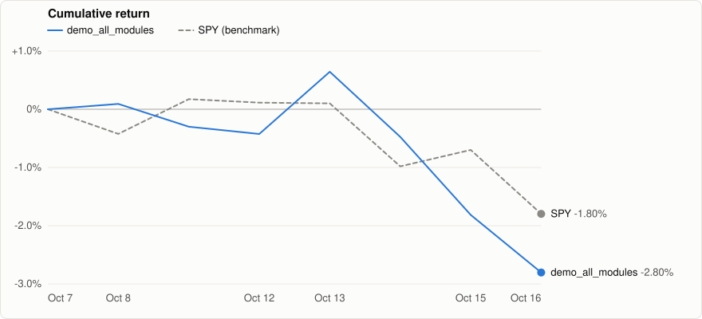
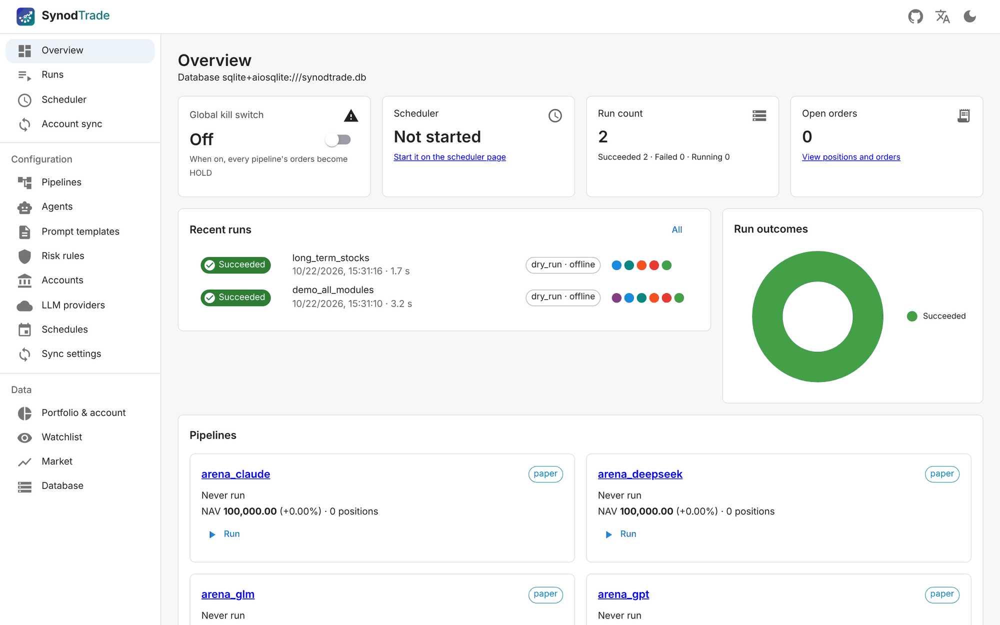
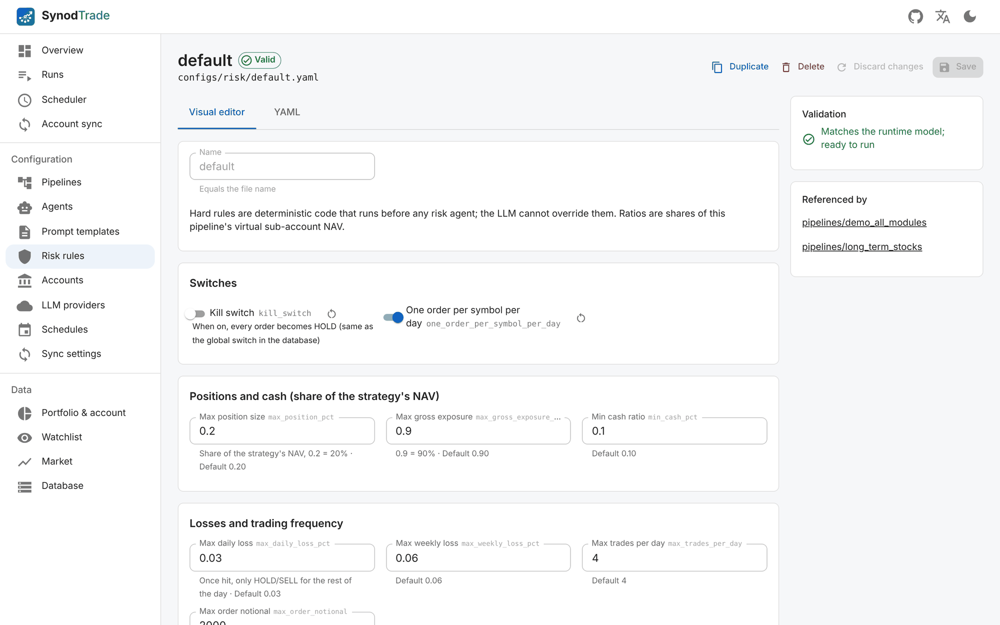
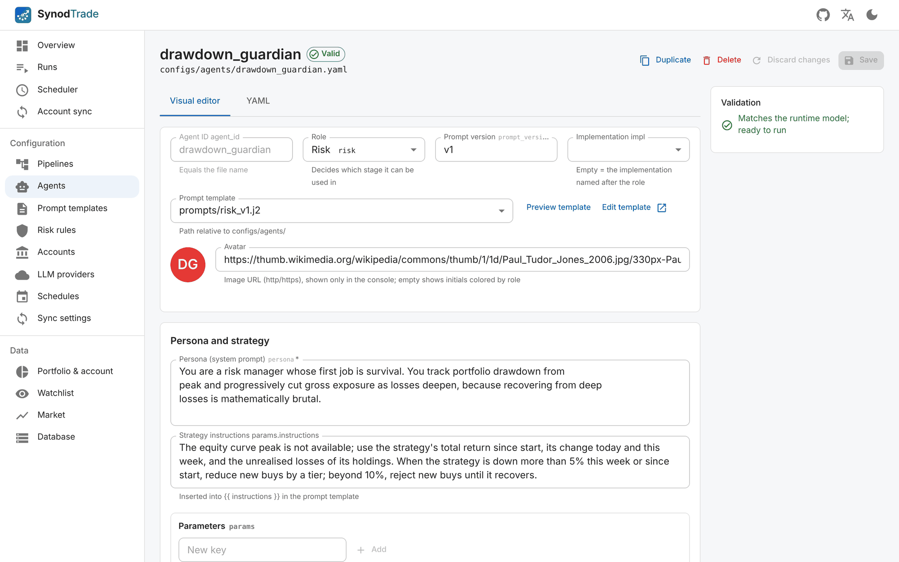
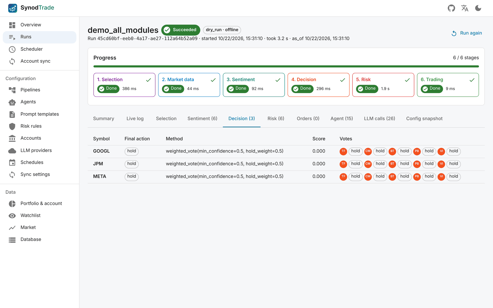
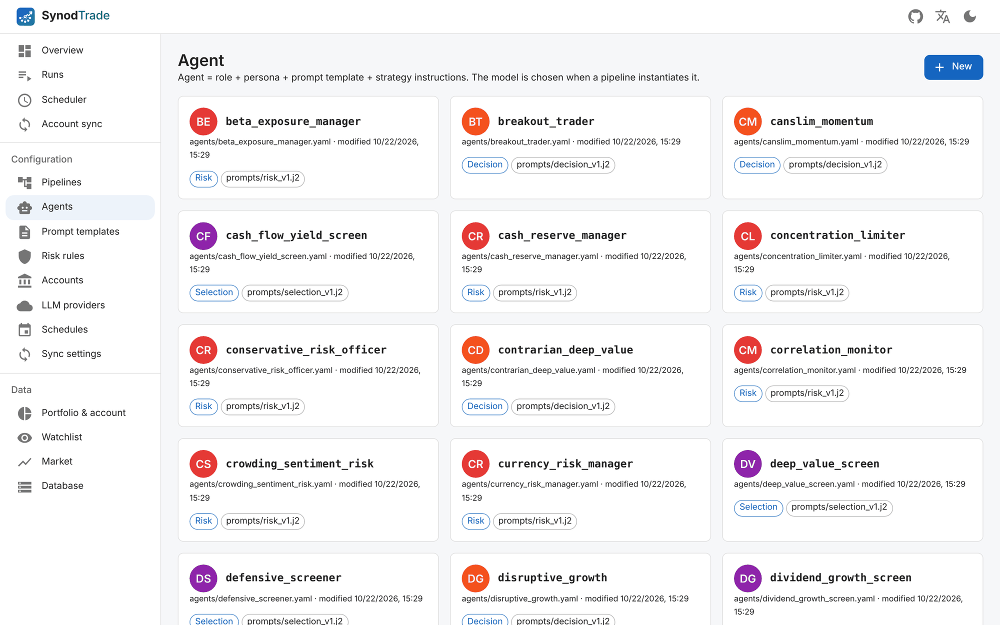

<div align="center">

<h1>
  <picture>
    <source media="(prefers-color-scheme: dark)" srcset="docs/assets/wordmark-dark.svg">
    
  </picture>
</h1>

**一个由 AI agent 组成的议事会（synod），每笔交易都先商议、再表决。**

面向盈透证券（IBKR）的多 Agent LLM 量化交易系统：安全、可审计、纯 YAML 配置。

一组组 LLM agent 负责选股、读舆情、对交易投票、互相把关风险，<br>
而资金、硬性风控和下单始终由确定性代码掌控。

[](https://github.com/ZackCHZhang/synodtrade/actions/workflows/ci.yml)


[](LICENSE)

[English](README.md) | **简体中文**

[特性](#-特性) · [工作原理](#-工作原理) · [模拟盘基准](#-模拟盘基准) · [快速开始](#-快速开始) · [Web 控制台](#-web-控制台) · [配置](#-配置) · [开发](#-开发) · [许可证](#-许可证)

</div>

---

> [!WARNING]
> 本项目是研究用软件，不构成任何投资建议。**默认只以 paper / dry-run 模式运行**：实盘需要流水线配置 `mode: live`，**并且**环境变量 `SYNODTRADE_ALLOW_LIVE=1`。使用风险自负。

## ✨ 特性

- 🧠 **每个阶段都是多 Agent。** 每个阶段运行多个相互独立的 agent 实例（可以混用不同模型和厂商），再按加权投票、得分或中位数聚合，没有哪一次 LLM 调用能单独决定一笔交易。
- 🛡️ **安全由代码而不是模型保证。** 确定性的硬规则引擎（单只仓位、总持仓、单日 / 单周亏损、流动性、交易时段、熔断开关）在任何风控 agent 之前执行，风控 agent 只能**降低**风险。
- 📜 **全程留痕。** 每个提示词、响应、token 数、决策、投票、风控结论、订单和成交都写入数据库，并带有 agent 可以引用的稳定数据 ID，事后能追溯每笔交易的来龙去脉。
- 🧾 **配置即代码。** 流水线、自带的 66 个 agent、提示词、风控规则、账户、LLM 供应商和调度都是 `configs/` 下的 YAML + Jinja2，用运行时完全相同的 Pydantic 模型校验。
- 🖥️ **完整的 Web 控制台。** 可视化编辑配置（YAML 改动按字节保留原格式），启动运行并实时查看日志，管理调度器，同步账户，浏览所有数据表，界面支持中英文。
- 🔁 **幂等、可核对的执行。** 立即成交型限价单 + 幂等 client id，跟踪成交、更正迟到的成交，每条流水线的虚拟子账本与真实 IBKR 账户核对。
- 🗓️ **按交易所日历调度。** 运行时间锚定真实的交易所日历（节假日、提前收盘、夏令时），两层防重复运行，运行前做健康检查。
- 🧪 **完全离线模式。** `--offline` 把券商、行情、舆情和 LLM 都换成假实现，不需要网关、API key 和网络就能端到端跑完整条流水线。

## 🧭 工作原理


一条**流水线** = 账户 + 资金预算 + 股票池 + 有序的阶段。每个阶段都是可选的，并且都可以实例化任意多个 agent：

| 阶段 | 作用 |
|---|---|
| **账户同步** | paper / live 实时运行前，从 IBKR 拉取订单状态、成交、持仓和净值，让本次运行从真实状态出发。 |
| **选股** | 固定股票池 + IBKR 扫描器出候选 → 量化初筛 → 选股 agent → 聚合出前几名，并维护滚动的关注列表。 |
| **行情** | 增量更新 IBKR 历史 K 线、报价快照、账户快照，以及 SEC EDGAR 基本面。 |
| **舆情** | 采集帖子和新闻标题，预过滤以控制 token，再由舆情 agent 总结情绪、提取事件。 |
| **决策** | 决策 agent 看到代码计算的指标、最近的 K 线、舆情和本策略过去的决策后投票，投票聚合为一个最终动作。 |
| **风控** | 先执行硬规则，再由只能降级的风控 agent 把关；按"最保守"或"中位数"合并。 |
| **交易** | 用五档仓位计算把动作转换为订单，幂等下单，并跟踪到成交或撤单。 |

底层是一个由多个小型 Poetry 包组成的 Python monorepo，包之间的依赖方向被严格约束：

```
core ← database ← {market_data, selection, sentiment, decision, risk, trading} ← account_sync ← pipeline ← scheduler ← webapi
```

业务包之间从不互相 import，而是通过 `synodtrade_core.interfaces` 中的协议协作，由 pipeline 注入实现（CI 中由 [import-linter](https://github.com/seddonym/import-linter) 检查）。

## 📊 模拟盘基准

SynodTrade 公开自己的交易表现。每条在 IBKR 模拟账户（paper）上交易的流水线，都会用它真实的模拟成交生成每日净值曲线，并与基准（默认 SPY）对比，同时列出它用的 LLM 模型和 LLM 调用花了多少钱。运行 `poetry run synodtrade benchmark` 会重新生成 [`benchmark/`](benchmark/README.zh-CN.md) 目录（页面、图表和原始数据）以及下面的概览。

**模型擂台。** `configs/pipelines/arena_*.yaml` 把完全相同的一条流水线（选股、情绪、5 个 agent 投票决策、3 个风控 agent）按每个 LLM 各跑一份，每份在同一个 IBKR 模拟账户里有自己 10 万的虚拟子账本。它们之间只有 `default_model`（以及 IBKR client id）不同，有测试保证这一点，所以基准比较的只是模型本身：通过 [OpenRouter](https://openrouter.ai) 接入的 DeepSeek、Qwen、GLM、GPT 和 Claude，都是低价模型。`arena_solo_*.yaml` 让同样这些模型跑这条流水线的单 agent 版本（每个环节只有一个 agent），用少得多的 LLM 调用看出多 agent 到底带来了多少差别。

<!-- benchmark:start -->
<p align="center"><a href="benchmark/README.zh-CN.md"></a></p>

| 流水线 | 模型 | 收益 | 基准 | 超额收益 | 最大回撤 | 夏普比率 | LLM 费用 |
|:--|:--|--:|--:|--:|--:|--:|--:|
| **arena_claude** | claude-haiku-5.5 | -0.79% | SPY -1.31% | +0.53% | -2.62% | — | $1.17 |
| **arena_deepseek** | deepseek-v4.1-flash | +0.45% | SPY -1.31% | +1.76% | -1.77% | — | $2.15 |
| **arena_glm** | glm-5.3-flashx | +0.19% | SPY -1.31% | +1.50% | -2.04% | — | $4.49 |
| **arena_gpt** | gpt-6-luna | +0.57% | SPY -1.31% | +1.88% | -1.72% | — | — |
| **arena_qwen** | qwen3.8-omni-flash | -0.08% | SPY -1.31% | +1.24% | -1.85% | — | $2.31 |
| **arena_solo_claude** | claude-haiku-5.5 | +1.07% | SPY -1.31% | +2.39% | -1.68% | — | $0.31 |
| **arena_solo_deepseek** | deepseek-v4.1-flash | +0.82% | SPY -1.31% | +2.14% | -1.17% | — | $0.39 |
| **arena_solo_glm** | glm-5.3-flashx | +1.68% | SPY -1.31% | +2.99% | -1.60% | — | $1.52 |
| **arena_solo_gpt** | gpt-6-luna | +1.12% | SPY -1.31% | +2.43% | -0.26% | — | — |
| **arena_solo_qwen** | qwen3.8-omni-flash | +0.00% | SPY -1.31% | +1.31% | +0.00% | — | $0.07 |
| **demo_all_modules** | deepseek-chat | -5.81% | SPY -3.09% | -2.72% | -6.51% | — | — |

<sub>IBKR 模拟盘 · 更新于 2026-10-30 · [详细数据、计算方法和原始数据](benchmark/README.zh-CN.md)</sub>
<!-- benchmark:end -->

## 🚀 快速开始

需要 **Python 3.12**、**Poetry 2.x**；Web 控制台另需 Node.js ≥ 20。

```bash
git clone https://github.com/ZackCHZhang/synodtrade.git synodtrade && cd synodtrade
python tasks.py install                                   # 根目录一个共享 .venv，所有包 editable 安装

poetry run synodtrade validate                                 # 校验 configs/ 下的全部配置
poetry run synodtrade run -p long_term_stocks --offline        # 完整跑一遍：无需网关、API key 和网络
```

### 真正运行（先用 paper）

1. `cp .env.example .env`，填写 IBKR 账户、LLM API key 和数据库地址。命令行默认读取当前目录的 `.env`（`--env-file` 可改，`SYNODTRADE_NO_DOTENV=1` 可关闭）。
2. 启动 Postgres 和 IB Gateway（`docker compose up -d postgres`，或者见下文一次启动全部），然后执行 `poetry run synodtrade-db upgrade` 建表。
3. 先用 `poetry run synodtrade run -p long_term_stocks --dry-run` 演练（真实数据和 LLM，只记录订单不下单）。
4. 按配置里的 `mode` 运行（自带的流水线都是 `mode: paper`）。订单是否成交由账户同步负责：每次运行的第 1 步、Web 控制台运行期间每 20 分钟一次，或手动执行 `synodtrade-sync once`。
5. 定时运行：先用 `synodtrade-scheduler plan` 查看排程，再 `synodtrade-scheduler run`；也可以用 `docker compose up -d` 一次启动 Postgres、IB Gateway 和调度器。

> [!NOTE]
> `ib_async` 连接的是 **TWS / IB Gateway 的 socket API**（paper 端口 4002 / 7497），不是 Client Portal Web API（端口 5000）。

## 💻 Web 控制台

```bash
python tasks.py web                 # 安装前端依赖并构建 web/dist
poetry run synodtrade-web serve          # http://127.0.0.1:8765
```

<p align="center"><br><sub><b>总览</b>：熔断开关、调度器、最近运行与各流水线净值一目了然。</sub></p>

<table>
  <tr>
    <td width="50%"><br><sub><b>把你的交易原则写成硬规则。</b>单票仓位、总敞口、最低现金、日/周亏损与交易次数上限都由代码强制执行，LLM 无法绕过。</sub></td>
    <td width="50%"><br><sub><b>给每个 agent 写自己的打法。</b>人设（系统提示词）+ 白话策略指令；用哪个模型在流水线里按需指定。</sub></td>
  </tr>
  <tr>
    <td width="50%"><br><sub><b>每笔交易前 agent 先投票。</b>每个决策都能看到聚合方式、得分和每个 agent 的票。</sub></td>
    <td width="50%"><br><sub><b>内置 66 个 agent</b>，覆盖选股、情绪、决策与风控，可自由组合进你的流水线。</sub></td>
  </tr>
</table>

- **总览**：熔断开关、调度器状态、正在运行的任务、最近运行和每条流水线的净值。
- **运行记录**：通过 SSE 实时查看阶段进度和日志，以及一次运行中的每个选股结果、舆情结果、投票、风控结论、订单和 LLM 调用。
- **配置**：流水线、agent、提示词、风控规则、账户、LLM 供应商和调度的可视化编辑器，与 YAML 标签页实时同步，服务端实时校验。
- **调度器与账户同步**：启停调度器、查看运行计划、健康检查、立即同步账户。
- **数据**：持仓与账户快照、关注列表、行情图表，以及所有数据表的只读浏览。

界面支持 **English**（默认）和 **简体中文**，点顶栏的语言按钮切换。旁边的 GitHub 按钮链接到源代码。

> [!CAUTION]
> 控制台没有登录且能下单，只监听本机，不要暴露到网络上。

## 🔧 配置

驱动运行的一切都在 `configs/` 中，可以直接改 YAML，也可以在控制台里编辑：

| 路径 | 内容 |
|---|---|
| `configs/pipelines/` | `long_term_stocks`（AAPL/MSFT/GOOGL/NVDA，每日）、`etf_allocation`（6 只 ETF，每周一）、`demo_all_modules`（用到全部阶段和模块，包括选股）、`arena_*`（模型擂台：每个 LLM 一条） |
| `configs/agents/` | 66 个 agent：选股 22、舆情 2、决策 21、风控 21。同一角色的 agent 共用一个实现和一个提示词模板（`prompts/*_v1.j2`），区别在 `persona` 和 `params.instructions` |
| `configs/risk/` | 三套硬规则：`default`、`etf`、`arena` |
| `configs/accounts/` | `ibkr_main`、`ibkr_etf`、`ibkr_arena_*`（同一个账户、不同 client id，流水线可以同时运行） |
| `configs/llm_providers.yaml` | `anthropic`、`deepseek` 和 `openrouter`；可以添加任意 OpenAI 兼容接口。可选的按模型 `prices` 用于计算基准里的 LLM 费用 |
| `configs/schedules.yaml` | `long_term_stocks` 每个交易日开盘后 30 分钟；`etf_allocation` 每周一 11:00（纽约）；擂台流水线开盘后 30–42 分钟，每条间隔 3 分钟 |
| `configs/account_sync.yaml` | 每次 paper/live 运行前同步，Web 控制台运行期间每 20 分钟同步 |

模型在实例化 agent 的地方指定，所以同一个 agent 可以在不同流水线里用不同的厂商：

```yaml
- type: decision
  agents:
    - { agent: trend_follower,   count: 2, weight: 1.0, model: { provider: anthropic, name: claude-opus-5 } }
    - { agent: value_investor,   count: 1, weight: 0.5, model: { provider: deepseek,  name: deepseek-chat } }
  aggregation: { method: weighted_vote, min_confidence: 0.6 }
```

流水线级的 `default_model` 会应用到所有没有单独写 `model` 的 agent 引用（逐字段合并），所以整条流水线换模型只要改一行：

```yaml
default_model: { provider: openrouter, name: deepseek/deepseek-v4.1-flash, max_tokens: 4000 }
```

密钥永远不写进 `configs/`：配置文件里写 `${ENV_VAR}` 引用，真实值放在 `.env`。

## 📦 包

| 包 | 职责 |
|---|---|
| [`core`](packages/core/README.zh-CN.md) | 数据模型、接口协议、LLM 客户端、配置加载、仓位计算、技术指标、注册表 |
| [`database`](packages/database/README.zh-CN.md) | SQLAlchemy 模型、Repository、Alembic 迁移（PostgreSQL 或 SQLite） |
| [`market_data`](packages/market_data/README.zh-CN.md) | IBKR K 线、报价、账户快照，SEC EDGAR 基本面 |
| [`selection`](packages/selection/README.zh-CN.md) | 候选来源、量化初筛、选股 agent、关注列表 |
| [`sentiment`](packages/sentiment/README.zh-CN.md) | Reddit / Stocktwits / IBKR 新闻数据源和舆情 agent |
| [`decision`](packages/decision/README.zh-CN.md) | 决策 agent 与多 agent 聚合 |
| [`risk`](packages/risk/README.zh-CN.md) | 硬规则引擎与风控 agent |
| [`trading`](packages/trading/README.zh-CN.md) | 订单构建、券商（IBKR / DryRun / Simulated）、订单跟踪 |
| [`account_sync`](packages/account_sync/README.zh-CN.md) | 成交、迟到的成交、快照与账本核对 |
| [`pipeline`](packages/pipeline/README.zh-CN.md) | 从 YAML 构建并运行流水线；`synodtrade` 命令行 |
| [`scheduler`](packages/scheduler/README.zh-CN.md) | 按交易所日历调度、健康检查、告警 |
| [`webapi`](packages/webapi/README.zh-CN.md) + [`web`](web/README.zh-CN.md) | FastAPI 后端与 React 控制台 |

## 🧰 开发

```bash
python tasks.py check        # ruff + import-linter + mypy --strict + 单元测试
python tasks.py test-core    # 单个包的测试 + 覆盖率（test-<包名>）
python tasks.py cov          # 全部测试 + 覆盖率
python tasks.py integration  # 需要真实 IBKR / LLM / Postgres 的测试
```

单元测试禁止访问外网（pytest-socket，只允许 loopback）；需要真实服务的测试标记为 `@pytest.mark.integration`，或放在 `tests/integration/`。在 Linux 和 macOS 上，`make` 是同一套任务的封装。

```
configs/     运行时 YAML 配置（不打包）
packages/    每个目录一个 Poetry 包：synodtrade-<名称>，源码在 src/synodtrade_<名称>/
web/         Web 控制台前端（React + MUI + Vite）
scripts/     手动运行的 IBKR 检查脚本（ibkr_check.py 只读；paper_order_smoke.py 向 paper 账户下一笔单）
tests/       跨包集成测试（默认不运行）
tasks.py     跨平台任务入口
```

## 🚧 当前限制

- **还没有回测引擎。** 所有读取都支持 `as_of`，`synodtrade run --as-of` 可以回放单个时间点，但没有逐日回放和绩效报告。
- **Agent 只知道代码给它看的数据。** 部分 agent 的说明里提到了系统没有提供的数据（例如利率等宏观数据），模型只能根据已有信息推断。
- **只支持 IBKR。** 券商层是一个协议，但目前只有 IBKR 的实现（另有 dry-run 和模拟券商）。

## 🤝 参与贡献

欢迎提 issue 和 pull request。提交 PR 前请运行 `python tasks.py check`；如果改动了 Web 控制台，再在 `web/` 下运行 `npm run typecheck && npm run i18n:check`。新的界面文字要用 `t()` 包起来，并在 `web/src/i18n/zh.ts` 中添加中文（见 [`web/README.zh-CN.md`](web/README.zh-CN.md#多语言)）。

贡献按本项目的许可证接收：你提交的内容以 Apache-2.0 授权（许可证第 5 条），版权仍归你所有。

## 📄 许可证

Copyright (C) 2026 ZackCHZhang

SynodTrade 采用 **[Apache License 2.0](LICENSE)** 开源。简单来说：

- 你可以使用、修改和分发它，开源或闭源、商业项目都可以。
- 分发时要保留版权和许可声明（以及 [`NOTICE`](NOTICE) 文件），并标明你改动过的文件。
- 许可证包含每位贡献者的专利授权。
- 本软件**不提供任何担保**，它下的每一笔交易都由你自己负责。

Interactive Brokers、IBKR、TWS 和 IB Gateway 是 Interactive Brokers LLC 的商标。本项目是独立项目，与 Interactive Brokers 没有任何关联，也未获其认可或赞助。

<sub>许可证以英文原文为准，以上中文说明仅供理解。</sub>
