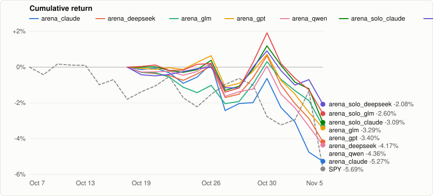

# Paper-trading benchmark

**English** | [简体中文](README.zh-CN.md)

> [!IMPORTANT]
> These are **paper-trading** results from IBKR paper accounts, not real money. Fills are real paper fills, but paper trading ignores market impact and can fill orders a live account would not. Past results say nothing about future ones. Not investment advice.

<sub>Updated 2026-11-06 · data through 2026-11-05</sub>

<p align="center"></p>

## Summary

| Pipeline | Model | Since | Return | Benchmark | Excess | Max drawdown | Sharpe | LLM cost |
|:--|:--|--:|--:|--:|--:|--:|--:|--:|
| **arena_claude** | claude-haiku-5.5 | 2026-10-16 | -5.27% | SPY -3.96% | -1.30% | -5.45% | — | $1.85 |
| **arena_deepseek** | deepseek-v4.1-flash | 2026-10-16 | -4.17% | SPY -3.96% | -0.21% | -4.79% | — | $3.32 |
| **arena_glm** | glm-5.3-flashx | 2026-10-16 | -3.29% | SPY -3.96% | +0.67% | -3.59% | — | $7.18 |
| **arena_gpt** | gpt-6-luna | 2026-10-16 | -3.40% | SPY -3.96% | +0.56% | -4.09% | — | — |
| **arena_qwen** | qwen3.8-omni-flash | 2026-10-16 | -4.36% | SPY -3.96% | -0.39% | -4.57% | — | $4.06 |
| **arena_solo_claude** | claude-haiku-5.5 | 2026-10-16 | -3.09% | SPY -3.96% | +0.87% | -4.23% | — | $0.47 |
| **arena_solo_deepseek** | deepseek-v4.1-flash | 2026-10-16 | -2.08% | SPY -3.96% | +1.89% | -2.96% | — | $0.59 |
| **arena_solo_glm** | glm-5.3-flashx | 2026-10-16 | -2.60% | SPY -3.96% | +1.36% | -4.43% | — | $2.30 |
| **arena_solo_gpt** | gpt-6-luna | 2026-10-16 | -1.13% | SPY -3.96% | +2.83% | -2.27% | — | — |
| **arena_solo_qwen** | qwen3.8-omni-flash | 2026-10-16 | -0.02% | SPY -3.96% | +3.94% | -0.02% | — | $0.15 |
| **demo_all_modules** | deepseek-chat | 2026-10-07 | -7.56% | SPY -5.69% | -1.87% | -8.15% | -7.72 | — |

## Pipelines

### arena_claude

| | |
|:--|--:|
| Models | `anthropic/claude-haiku-5.5` |
| Mode | paper |
| Sessions | 14 |
| Starting capital | 100,000.00 |
| First paper/live run | 2026-10-19 15:10 UTC |
| Net asset value | 94,734.53 (-5.27%) |
| Fills (buys / sells) | 23 (9 / 14) |
| Sells at a profit | 0.00% |
| Realised P&L | -4,316.91 |
| Commissions | 22.91 |
| Open positions | 4 |
| Invested | 31.59% |
| Volatility (annualised) | — |
| CAGR | — |
| Benchmark max drawdown | -5.19% |
| LLM calls | 2032 |
| LLM tokens (in / out / cache read) | 10.72M / 1.56M / 0 |
| LLM cost (total / last 7 days) | $1.85 / $0.80 |

### arena_deepseek

| | |
|:--|--:|
| Models | `deepseek/deepseek-v4.1-flash` |
| Mode | paper |
| Sessions | 14 |
| Starting capital | 100,000.00 |
| First paper/live run | 2026-10-19 13:50 UTC |
| Net asset value | 95,825.56 (-4.17%) |
| Fills (buys / sells) | 55 (24 / 31) |
| Sells at a profit | 3.23% |
| Realised P&L | -5,055.04 |
| Commissions | 55.15 |
| Open positions | 6 |
| Invested | 52.89% |
| Volatility (annualised) | — |
| CAGR | — |
| Benchmark max drawdown | -5.19% |
| LLM calls | 2873 |
| LLM tokens (in / out / cache read) | 11.11M / 2.85M / 381.7k |
| LLM cost (total / last 7 days) | $3.32 / $1.27 |

### arena_glm

| | |
|:--|--:|
| Models | `z-ai/glm-5.3-flashx` |
| Mode | paper |
| Sessions | 14 |
| Starting capital | 100,000.00 |
| First paper/live run | 2026-10-19 14:30 UTC |
| Net asset value | 96,709.62 (-3.29%) |
| Fills (buys / sells) | 52 (21 / 31) |
| Sells at a profit | 0.00% |
| Realised P&L | -4,537.15 |
| Commissions | 53.13 |
| Open positions | 6 |
| Invested | 65.22% |
| Volatility (annualised) | — |
| CAGR | — |
| Benchmark max drawdown | -5.19% |
| LLM calls | 2070 |
| LLM tokens (in / out / cache read) | 8.41M / 3.45M / 895.0k |
| LLM cost (total / last 7 days) | $7.18 / $2.97 |

### arena_gpt

| | |
|:--|--:|
| Models | `openai/gpt-6-luna` |
| Mode | paper |
| Sessions | 14 |
| Starting capital | 100,000.00 |
| First paper/live run | 2026-10-19 14:50 UTC |
| Net asset value | 96,598.79 (-3.40%) |
| Fills (buys / sells) | 22 (8 / 14) |
| Sells at a profit | 0.00% |
| Realised P&L | -3,490.98 |
| Commissions | 21.72 |
| Open positions | 4 |
| Invested | 30.84% |
| Volatility (annualised) | — |
| CAGR | — |
| Benchmark max drawdown | -5.19% |
| LLM calls | 2260 |
| LLM tokens (in / out / cache read) | 7.66M / 939.5k / 0 |
| LLM cost (total / last 7 days) | — / $0.49 |

### arena_qwen

| | |
|:--|--:|
| Models | `qwen/qwen3.8-omni-flash` |
| Mode | paper |
| Sessions | 14 |
| Starting capital | 100,000.00 |
| First paper/live run | 2026-10-19 14:10 UTC |
| Net asset value | 95,643.12 (-4.36%) |
| Fills (buys / sells) | 31 (9 / 22) |
| Sells at a profit | 4.55% |
| Realised P&L | -4,570.34 |
| Commissions | 32.10 |
| Open positions | 3 |
| Invested | 22.50% |
| Volatility (annualised) | — |
| CAGR | — |
| Benchmark max drawdown | -5.19% |
| LLM calls | 2287 |
| LLM tokens (in / out / cache read) | 9.78M / 5.59M / 224.0k |
| LLM cost (total / last 7 days) | $4.06 / $1.91 |

### arena_solo_claude

| | |
|:--|--:|
| Models | `anthropic/claude-haiku-5.5` |
| Mode | paper |
| Sessions | 14 |
| Starting capital | 100,000.00 |
| First paper/live run | 2026-10-19 15:20 UTC |
| Net asset value | 96,908.03 (-3.09%) |
| Fills (buys / sells) | 29 (17 / 12) |
| Sells at a profit | 0.00% |
| Realised P&L | -3,679.10 |
| Commissions | 29.66 |
| Open positions | 6 |
| Invested | 61.30% |
| Volatility (annualised) | — |
| CAGR | — |
| Benchmark max drawdown | -5.19% |
| LLM calls | 613 |
| LLM tokens (in / out / cache read) | 2.49M / 449.7k / 0 |
| LLM cost (total / last 7 days) | $0.47 / $0.19 |

### arena_solo_deepseek

| | |
|:--|--:|
| Models | `deepseek/deepseek-v4.1-flash` |
| Mode | paper |
| Sessions | 14 |
| Starting capital | 100,000.00 |
| First paper/live run | 2026-10-19 14:00 UTC |
| Net asset value | 97,924.35 (-2.08%) |
| Fills (buys / sells) | 21 (12 / 9) |
| Sells at a profit | 0.00% |
| Realised P&L | -2,565.49 |
| Commissions | 21.45 |
| Open positions | 8 |
| Invested | 65.75% |
| Volatility (annualised) | — |
| CAGR | — |
| Benchmark max drawdown | -5.19% |
| LLM calls | 558 |
| LLM tokens (in / out / cache read) | 1.69M / 583.6k / 66.9k |
| LLM cost (total / last 7 days) | $0.59 / $0.23 |

### arena_solo_glm

| | |
|:--|--:|
| Models | `z-ai/glm-5.3-flashx` |
| Mode | paper |
| Sessions | 14 |
| Starting capital | 100,000.00 |
| First paper/live run | 2026-10-19 14:40 UTC |
| Net asset value | 97,400.95 (-2.60%) |
| Fills (buys / sells) | 35 (19 / 16) |
| Sells at a profit | 0.00% |
| Realised P&L | -3,019.66 |
| Commissions | 32.22 |
| Open positions | 9 |
| Invested | 60.66% |
| Volatility (annualised) | — |
| CAGR | — |
| Benchmark max drawdown | -5.19% |
| LLM calls | 797 |
| LLM tokens (in / out / cache read) | 2.41M / 1.18M / 240.6k |
| LLM cost (total / last 7 days) | $2.30 / $0.87 |

### arena_solo_gpt

| | |
|:--|--:|
| Models | `openai/gpt-6-luna` |
| Mode | paper |
| Sessions | 14 |
| Starting capital | 100,000.00 |
| First paper/live run | 2026-10-19 15:00 UTC |
| Net asset value | 98,867.72 (-1.13%) |
| Fills (buys / sells) | 7 (3 / 4) |
| Sells at a profit | 0.00% |
| Realised P&L | -730.28 |
| Commissions | 7.22 |
| Open positions | 3 |
| Invested | 26.19% |
| Volatility (annualised) | — |
| CAGR | — |
| Benchmark max drawdown | -5.19% |
| LLM calls | 693 |
| LLM tokens (in / out / cache read) | 1.96M / 277.2k / 0 |
| LLM cost (total / last 7 days) | — / $0.11 |

### arena_solo_qwen

| | |
|:--|--:|
| Models | `qwen/qwen3.8-omni-flash` |
| Mode | paper |
| Sessions | 14 |
| Starting capital | 100,000.00 |
| First paper/live run | 2026-10-19 14:20 UTC |
| Net asset value | 99,979.22 (-0.02%) |
| Fills (buys / sells) | 1 (1 / 0) |
| Sells at a profit | — |
| Realised P&L | 0.00 |
| Commissions | 1.00 |
| Open positions | 1 |
| Invested | 14.80% |
| Volatility (annualised) | — |
| CAGR | — |
| Benchmark max drawdown | -5.19% |
| LLM calls | 99 |
| LLM tokens (in / out / cache read) | 324.2k / 212.0k / 0 |
| LLM cost (total / last 7 days) | $0.15 / $0.07 |

### demo_all_modules

| | |
|:--|--:|
| Models | `deepseek-chat` |
| Mode | paper |
| Sessions | 21 |
| Starting capital | 10,000.00 |
| First paper/live run | 2026-10-08 13:40 UTC |
| Net asset value | 9,244.11 (-7.56%) |
| Fills (buys / sells) | 45 (18 / 27) |
| Sells at a profit | 0.00% |
| Realised P&L | -790.13 |
| Commissions | 41.52 |
| Open positions | 4 |
| Invested | 40.68% |
| Volatility (annualised) | 12.10% |
| CAGR | — |
| Benchmark max drawdown | -5.85% |
| LLM calls | 4947 |
| LLM tokens (in / out / cache read) | 18.89M / 1.57M / 1.22M |
| LLM cost (total / last 7 days) | — / — |

## Methodology

- Each pipeline trades a virtual sub-account that starts at its `budget.max_capital` on the day of its first paper or live run; the base day (0%) is the last session before it.
- Every session, the pipeline's fills up to that day are booked with the same arithmetic as the trading ledger (commissions included) and open positions are valued at that day's close (the last known close when a symbol has no bar).
- The benchmark is the pipeline's `benchmark` symbol (SPY by default), indexed to the same base day. Excess = return − benchmark return.
- Sharpe and volatility are annualised from daily returns (252 sessions, risk-free rate 0) and need at least 20 sessions; CAGR needs at least 60. A dash means not enough data.
- LLM cost is the pipeline's recorded token usage (every attempt, including retries) priced at the list prices in `configs/llm_providers.yaml`; a dash means a model has no price. It is an estimate: providers may bill differently (routing, discounts, time of day).
- Dry-run and offline runs are never included.

## Reproduce

Generated from the trading database with the command below. The daily series of every pipeline is in [`data.json`](data.json).

```bash
poetry run synodtrade benchmark
```
