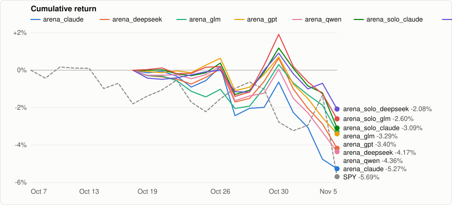

# 模拟盘（paper）基准

[English](README.md) | **简体中文**

> [!IMPORTANT]
> 以下是 IBKR **模拟账户（paper）**的交易结果，不是真实资金。成交来自模拟账户的真实成交记录，但模拟盘不考虑市场冲击，有些订单在实盘中未必能成交。过去的结果不代表未来，不构成投资建议。

<sub>更新于 2026-11-06 · 数据截至 2026-11-05</sub>

<p align="center"></p>

## 概览

| 流水线 | 模型 | 开始 | 收益 | 基准 | 超额收益 | 最大回撤 | 夏普比率 | LLM 费用 |
|:--|:--|--:|--:|--:|--:|--:|--:|--:|
| **arena_claude** | claude-haiku-5.5 | 2026-10-16 | -5.27% | SPY -3.96% | -1.30% | -5.45% | — | $1.85 |
| **arena_deepseek** | deepseek-v4.1-flash | 2026-10-16 | -4.17% | SPY -3.96% | -0.21% | -4.79% | — | $3.32 |
| **arena_glm** | glm-5.3-flashx | 2026-10-16 | -3.29% | SPY -3.96% | +0.67% | -3.59% | — | $7.18 |
| **arena_gpt** | gpt-6-luna | 2026-10-16 | -3.40% | SPY -3.96% | +0.56% | -4.09% | — | — |
| **arena_qwen** | qwen3.8-omni-flash | 2026-10-16 | -4.36% | SPY -3.96% | -0.39% | -4.57% | — | $4.06 |
| **arena_solo_claude** | claude-haiku-5.5 | 2026-10-16 | -3.09% | SPY -3.96% | +0.87% | -4.23% | — | $0.47 |
| **arena_solo_deepseek** | deepseek-v4.1-flash | 2026-10-16 | -2.08% | SPY -3.96% | +1.89% | -2.96% | — | $0.59 |
| **arena_solo_glm** | glm-5.3-flashx | 2026-10-16 | -2.60% | SPY -3.96% | +1.36% | -4.43% | — | $2.30 |
| **arena_solo_gpt** | gpt-6-luna | 2026-10-16 | -1.13% | SPY -3.96% | +2.83% | -2.27% | — | — |
| **arena_solo_qwen** | qwen3.8-omni-flash | 2026-10-16 | -0.02% | SPY -3.96% | +3.94% | -0.02% | — | $0.15 |
| **demo_all_modules** | deepseek-chat | 2026-10-07 | -7.56% | SPY -5.69% | -1.87% | -8.15% | -7.72 | — |

## 各流水线

### arena_claude

| | |
|:--|--:|
| 模型 | `anthropic/claude-haiku-5.5` |
| 模式 | paper |
| 交易日 | 14 |
| 初始资金 | 100,000.00 |
| 首次 paper/live 运行 | 2026-10-19 15:10 UTC |
| 当前净值 | 94,734.53 (-5.27%) |
| 成交（买 / 卖） | 23 (9 / 14) |
| 盈利卖出占比 | 0.00% |
| 已实现盈亏 | -4,316.91 |
| 佣金 | 22.91 |
| 持仓数 | 4 |
| 仓位占比 | 31.59% |
| 波动率（年化） | — |
| 年化收益 | — |
| 基准最大回撤 | -5.19% |
| LLM 调用次数 | 2032 |
| LLM token（输入 / 输出 / 缓存命中） | 10.72M / 1.56M / 0 |
| LLM 费用（累计 / 最近 7 天） | $1.85 / $0.80 |

### arena_deepseek

| | |
|:--|--:|
| 模型 | `deepseek/deepseek-v4.1-flash` |
| 模式 | paper |
| 交易日 | 14 |
| 初始资金 | 100,000.00 |
| 首次 paper/live 运行 | 2026-10-19 13:50 UTC |
| 当前净值 | 95,825.56 (-4.17%) |
| 成交（买 / 卖） | 55 (24 / 31) |
| 盈利卖出占比 | 3.23% |
| 已实现盈亏 | -5,055.04 |
| 佣金 | 55.15 |
| 持仓数 | 6 |
| 仓位占比 | 52.89% |
| 波动率（年化） | — |
| 年化收益 | — |
| 基准最大回撤 | -5.19% |
| LLM 调用次数 | 2873 |
| LLM token（输入 / 输出 / 缓存命中） | 11.11M / 2.85M / 381.7k |
| LLM 费用（累计 / 最近 7 天） | $3.32 / $1.27 |

### arena_glm

| | |
|:--|--:|
| 模型 | `z-ai/glm-5.3-flashx` |
| 模式 | paper |
| 交易日 | 14 |
| 初始资金 | 100,000.00 |
| 首次 paper/live 运行 | 2026-10-19 14:30 UTC |
| 当前净值 | 96,709.62 (-3.29%) |
| 成交（买 / 卖） | 52 (21 / 31) |
| 盈利卖出占比 | 0.00% |
| 已实现盈亏 | -4,537.15 |
| 佣金 | 53.13 |
| 持仓数 | 6 |
| 仓位占比 | 65.22% |
| 波动率（年化） | — |
| 年化收益 | — |
| 基准最大回撤 | -5.19% |
| LLM 调用次数 | 2070 |
| LLM token（输入 / 输出 / 缓存命中） | 8.41M / 3.45M / 895.0k |
| LLM 费用（累计 / 最近 7 天） | $7.18 / $2.97 |

### arena_gpt

| | |
|:--|--:|
| 模型 | `openai/gpt-6-luna` |
| 模式 | paper |
| 交易日 | 14 |
| 初始资金 | 100,000.00 |
| 首次 paper/live 运行 | 2026-10-19 14:50 UTC |
| 当前净值 | 96,598.79 (-3.40%) |
| 成交（买 / 卖） | 22 (8 / 14) |
| 盈利卖出占比 | 0.00% |
| 已实现盈亏 | -3,490.98 |
| 佣金 | 21.72 |
| 持仓数 | 4 |
| 仓位占比 | 30.84% |
| 波动率（年化） | — |
| 年化收益 | — |
| 基准最大回撤 | -5.19% |
| LLM 调用次数 | 2260 |
| LLM token（输入 / 输出 / 缓存命中） | 7.66M / 939.5k / 0 |
| LLM 费用（累计 / 最近 7 天） | — / $0.49 |

### arena_qwen

| | |
|:--|--:|
| 模型 | `qwen/qwen3.8-omni-flash` |
| 模式 | paper |
| 交易日 | 14 |
| 初始资金 | 100,000.00 |
| 首次 paper/live 运行 | 2026-10-19 14:10 UTC |
| 当前净值 | 95,643.12 (-4.36%) |
| 成交（买 / 卖） | 31 (9 / 22) |
| 盈利卖出占比 | 4.55% |
| 已实现盈亏 | -4,570.34 |
| 佣金 | 32.10 |
| 持仓数 | 3 |
| 仓位占比 | 22.50% |
| 波动率（年化） | — |
| 年化收益 | — |
| 基准最大回撤 | -5.19% |
| LLM 调用次数 | 2287 |
| LLM token（输入 / 输出 / 缓存命中） | 9.78M / 5.59M / 224.0k |
| LLM 费用（累计 / 最近 7 天） | $4.06 / $1.91 |

### arena_solo_claude

| | |
|:--|--:|
| 模型 | `anthropic/claude-haiku-5.5` |
| 模式 | paper |
| 交易日 | 14 |
| 初始资金 | 100,000.00 |
| 首次 paper/live 运行 | 2026-10-19 15:20 UTC |
| 当前净值 | 96,908.03 (-3.09%) |
| 成交（买 / 卖） | 29 (17 / 12) |
| 盈利卖出占比 | 0.00% |
| 已实现盈亏 | -3,679.10 |
| 佣金 | 29.66 |
| 持仓数 | 6 |
| 仓位占比 | 61.30% |
| 波动率（年化） | — |
| 年化收益 | — |
| 基准最大回撤 | -5.19% |
| LLM 调用次数 | 613 |
| LLM token（输入 / 输出 / 缓存命中） | 2.49M / 449.7k / 0 |
| LLM 费用（累计 / 最近 7 天） | $0.47 / $0.19 |

### arena_solo_deepseek

| | |
|:--|--:|
| 模型 | `deepseek/deepseek-v4.1-flash` |
| 模式 | paper |
| 交易日 | 14 |
| 初始资金 | 100,000.00 |
| 首次 paper/live 运行 | 2026-10-19 14:00 UTC |
| 当前净值 | 97,924.35 (-2.08%) |
| 成交（买 / 卖） | 21 (12 / 9) |
| 盈利卖出占比 | 0.00% |
| 已实现盈亏 | -2,565.49 |
| 佣金 | 21.45 |
| 持仓数 | 8 |
| 仓位占比 | 65.75% |
| 波动率（年化） | — |
| 年化收益 | — |
| 基准最大回撤 | -5.19% |
| LLM 调用次数 | 558 |
| LLM token（输入 / 输出 / 缓存命中） | 1.69M / 583.6k / 66.9k |
| LLM 费用（累计 / 最近 7 天） | $0.59 / $0.23 |

### arena_solo_glm

| | |
|:--|--:|
| 模型 | `z-ai/glm-5.3-flashx` |
| 模式 | paper |
| 交易日 | 14 |
| 初始资金 | 100,000.00 |
| 首次 paper/live 运行 | 2026-10-19 14:40 UTC |
| 当前净值 | 97,400.95 (-2.60%) |
| 成交（买 / 卖） | 35 (19 / 16) |
| 盈利卖出占比 | 0.00% |
| 已实现盈亏 | -3,019.66 |
| 佣金 | 32.22 |
| 持仓数 | 9 |
| 仓位占比 | 60.66% |
| 波动率（年化） | — |
| 年化收益 | — |
| 基准最大回撤 | -5.19% |
| LLM 调用次数 | 797 |
| LLM token（输入 / 输出 / 缓存命中） | 2.41M / 1.18M / 240.6k |
| LLM 费用（累计 / 最近 7 天） | $2.30 / $0.87 |

### arena_solo_gpt

| | |
|:--|--:|
| 模型 | `openai/gpt-6-luna` |
| 模式 | paper |
| 交易日 | 14 |
| 初始资金 | 100,000.00 |
| 首次 paper/live 运行 | 2026-10-19 15:00 UTC |
| 当前净值 | 98,867.72 (-1.13%) |
| 成交（买 / 卖） | 7 (3 / 4) |
| 盈利卖出占比 | 0.00% |
| 已实现盈亏 | -730.28 |
| 佣金 | 7.22 |
| 持仓数 | 3 |
| 仓位占比 | 26.19% |
| 波动率（年化） | — |
| 年化收益 | — |
| 基准最大回撤 | -5.19% |
| LLM 调用次数 | 693 |
| LLM token（输入 / 输出 / 缓存命中） | 1.96M / 277.2k / 0 |
| LLM 费用（累计 / 最近 7 天） | — / $0.11 |

### arena_solo_qwen

| | |
|:--|--:|
| 模型 | `qwen/qwen3.8-omni-flash` |
| 模式 | paper |
| 交易日 | 14 |
| 初始资金 | 100,000.00 |
| 首次 paper/live 运行 | 2026-10-19 14:20 UTC |
| 当前净值 | 99,979.22 (-0.02%) |
| 成交（买 / 卖） | 1 (1 / 0) |
| 盈利卖出占比 | — |
| 已实现盈亏 | 0.00 |
| 佣金 | 1.00 |
| 持仓数 | 1 |
| 仓位占比 | 14.80% |
| 波动率（年化） | — |
| 年化收益 | — |
| 基准最大回撤 | -5.19% |
| LLM 调用次数 | 99 |
| LLM token（输入 / 输出 / 缓存命中） | 324.2k / 212.0k / 0 |
| LLM 费用（累计 / 最近 7 天） | $0.15 / $0.07 |

### demo_all_modules

| | |
|:--|--:|
| 模型 | `deepseek-chat` |
| 模式 | paper |
| 交易日 | 21 |
| 初始资金 | 10,000.00 |
| 首次 paper/live 运行 | 2026-10-08 13:40 UTC |
| 当前净值 | 9,244.11 (-7.56%) |
| 成交（买 / 卖） | 45 (18 / 27) |
| 盈利卖出占比 | 0.00% |
| 已实现盈亏 | -790.13 |
| 佣金 | 41.52 |
| 持仓数 | 4 |
| 仓位占比 | 40.68% |
| 波动率（年化） | 12.10% |
| 年化收益 | — |
| 基准最大回撤 | -5.85% |
| LLM 调用次数 | 4947 |
| LLM token（输入 / 输出 / 缓存命中） | 18.89M / 1.57M / 1.22M |
| LLM 费用（累计 / 最近 7 天） | — / — |

## 计算方法

- 每条流水线有一个虚拟子账户，从首次 paper 或 live 运行当天起，以 `budget.max_capital` 为初始资金；基准日（0%）是那之前的最后一个交易日。
- 每个交易日，按与交易账本完全相同的方法（含佣金）记入截至当天的成交，持仓按当天收盘价估值（某只股票当天没有 K 线时用最近一次收盘价）。
- 基准是流水线配置的 `benchmark`（默认 SPY），从同一个基准日开始计算。超额收益 = 收益 − 基准收益。
- 夏普比率和波动率由日收益年化（每年 252 个交易日，无风险利率按 0），至少需要 20 个交易日；年化收益至少需要 60 个交易日。显示为短横线表示数据还不够。
- LLM 费用 = 流水线记录的 token 用量（含每次重试）× `configs/llm_providers.yaml` 里的标价；显示为短横线表示有模型没有配置价格。这是估算，实际账单可能因路由、折扣或时段而不同。
- dry-run 和离线运行永远不计入。

## 复现

用下面的命令从交易数据库生成。每条流水线的每日数据在 [`data.json`](data.json)。

```bash
poetry run synodtrade benchmark
```
