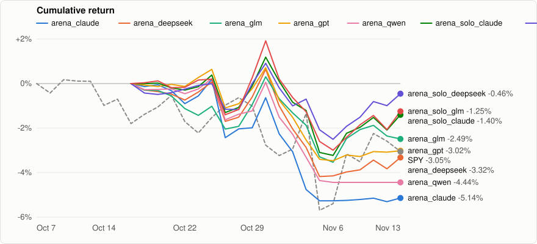

# 模拟盘（paper）基准

[English](README.md) | **简体中文**

> [!IMPORTANT]
> 以下是 IBKR **模拟账户（paper）**的交易结果，不是真实资金。成交来自模拟账户的真实成交记录，但模拟盘不考虑市场冲击，有些订单在实盘中未必能成交。过去的结果不代表未来，不构成投资建议。

<sub>更新于 2026-11-14 · 数据截至 2026-11-13</sub>

<p align="center"></p>

## 概览

| 流水线 | 模型 | 开始 | 收益 | 基准 | 超额收益 | 最大回撤 | 夏普比率 | LLM 费用 |
|:--|:--|--:|--:|--:|--:|--:|--:|--:|
| **arena_claude** | claude-haiku-5.5 | 2026-10-16 | -5.14% | SPY -1.28% | -3.86% | -5.49% | -4.57 | $2.50 |
| **arena_deepseek** | deepseek-v4.1-flash | 2026-10-16 | -3.32% | SPY -1.28% | -2.04% | -4.79% | -3.24 | $4.08 |
| **arena_glm** | glm-5.3-flashx | 2026-10-16 | -2.49% | SPY -1.28% | -1.21% | -3.83% | -2.75 | $10.16 |
| **arena_gpt** | gpt-6-luna | 2026-10-16 | -3.02% | SPY -1.28% | -1.74% | -4.15% | -3.49 | — |
| **arena_qwen** | qwen3.8-omni-flash | 2026-10-16 | -4.44% | SPY -1.28% | -3.16% | -4.65% | -4.93 | $5.50 |
| **arena_solo_claude** | claude-haiku-5.5 | 2026-10-16 | -1.40% | SPY -1.28% | -0.12% | -4.36% | -1.25 | $0.65 |
| **arena_solo_deepseek** | deepseek-v4.1-flash | 2026-10-16 | -0.46% | SPY -1.28% | +0.82% | -3.38% | -0.47 | $0.93 |
| **arena_solo_glm** | glm-5.3-flashx | 2026-10-16 | -1.25% | SPY -1.28% | +0.03% | -4.82% | -1.03 | $3.37 |
| **arena_solo_gpt** | gpt-6-luna | 2026-10-16 | +0.00% | SPY -1.28% | +1.28% | -2.30% | 0.03 | — |
| **arena_solo_qwen** | qwen3.8-omni-flash | 2026-10-16 | +0.86% | SPY -1.28% | +2.14% | -0.17% | 5.03 | $0.61 |
| **demo_all_modules** | deepseek-chat | 2026-10-07 | -6.76% | SPY -3.05% | -3.70% | -8.25% | -5.66 | — |

## 各流水线

### arena_claude

| | |
|:--|--:|
| 模型 | `anthropic/claude-haiku-5.5` |
| 模式 | paper |
| 交易日 | 20 |
| 初始资金 | 100,000.00 |
| 首次 paper/live 运行 | 2026-10-19 15:10 UTC |
| 当前净值 | 94,861.11 (-5.14%) |
| 成交（买 / 卖） | 26 (10 / 16) |
| 盈利卖出占比 | 0.00% |
| 已实现盈亏 | -5,193.95 |
| 佣金 | 26.27 |
| 持仓数 | 3 |
| 仓位占比 | 25.65% |
| 波动率（年化） | 14.31% |
| 年化收益 | — |
| 基准最大回撤 | -5.19% |
| LLM 调用次数 | 2721 |
| LLM token（输入 / 输出 / 缓存命中） | 14.55M / 2.09M / 0 |
| LLM 费用（累计 / 最近 7 天） | $2.50 / $0.49 |

### arena_deepseek

| | |
|:--|--:|
| 模型 | `deepseek/deepseek-v4.1-flash` |
| 模式 | paper |
| 交易日 | 20 |
| 初始资金 | 100,000.00 |
| 首次 paper/live 运行 | 2026-10-19 13:50 UTC |
| 当前净值 | 96,679.28 (-3.32%) |
| 成交（买 / 卖） | 65 (28 / 37) |
| 盈利卖出占比 | 10.81% |
| 已实现盈亏 | -4,139.54 |
| 佣金 | 66.12 |
| 持仓数 | 4 |
| 仓位占比 | 49.50% |
| 波动率（年化） | 12.89% |
| 年化收益 | — |
| 基准最大回撤 | -5.19% |
| LLM 调用次数 | 3467 |
| LLM token（输入 / 输出 / 缓存命中） | 13.68M / 3.48M / 405.4k |
| LLM 费用（累计 / 最近 7 天） | $4.08 / $0.54 |

### arena_glm

| | |
|:--|--:|
| 模型 | `z-ai/glm-5.3-flashx` |
| 模式 | paper |
| 交易日 | 20 |
| 初始资金 | 100,000.00 |
| 首次 paper/live 运行 | 2026-10-19 14:30 UTC |
| 当前净值 | 97,511.10 (-2.49%) |
| 成交（买 / 卖） | 59 (25 / 34) |
| 盈利卖出占比 | 0.00% |
| 已实现盈亏 | -5,290.89 |
| 佣金 | 60.51 |
| 持仓数 | 6 |
| 仓位占比 | 66.98% |
| 波动率（年化） | 11.30% |
| 年化收益 | — |
| 基准最大回撤 | -5.19% |
| LLM 调用次数 | 2901 |
| LLM token（输入 / 输出 / 缓存命中） | 12.08M / 4.86M / 1.37M |
| LLM 费用（累计 / 最近 7 天） | $10.16 / $2.30 |

### arena_gpt

| | |
|:--|--:|
| 模型 | `openai/gpt-6-luna` |
| 模式 | paper |
| 交易日 | 20 |
| 初始资金 | 100,000.00 |
| 首次 paper/live 运行 | 2026-10-19 14:50 UTC |
| 当前净值 | 96,984.90 (-3.02%) |
| 成交（买 / 卖） | 27 (8 / 19) |
| 盈利卖出占比 | 10.53% |
| 已实现盈亏 | -3,438.49 |
| 佣金 | 27.12 |
| 持仓数 | 1 |
| 仓位占比 | 11.41% |
| 波动率（年化） | 10.88% |
| 年化收益 | — |
| 基准最大回撤 | -5.19% |
| LLM 调用次数 | 2974 |
| LLM token（输入 / 输出 / 缓存命中） | 10.47M / 1.25M / 0 |
| LLM 费用（累计 / 最近 7 天） | — / $0.34 |

### arena_qwen

| | |
|:--|--:|
| 模型 | `qwen/qwen3.8-omni-flash` |
| 模式 | paper |
| 交易日 | 20 |
| 初始资金 | 100,000.00 |
| 首次 paper/live 运行 | 2026-10-19 14:10 UTC |
| 当前净值 | 95,560.66 (-4.44%) |
| 成交（买 / 卖） | 34 (9 / 25) |
| 盈利卖出占比 | 8.00% |
| 已实现盈亏 | -4,439.34 |
| 佣金 | 35.54 |
| 持仓数 | 0 |
| 仓位占比 | 0.00% |
| 波动率（年化） | 11.47% |
| 年化收益 | — |
| 基准最大回撤 | -5.19% |
| LLM 调用次数 | 3108 |
| LLM token（输入 / 输出 / 缓存命中） | 13.61M / 7.49M / 455.2k |
| LLM 费用（累计 / 最近 7 天） | $5.50 / $1.12 |

### arena_solo_claude

| | |
|:--|--:|
| 模型 | `anthropic/claude-haiku-5.5` |
| 模式 | paper |
| 交易日 | 20 |
| 初始资金 | 100,000.00 |
| 首次 paper/live 运行 | 2026-10-19 15:20 UTC |
| 当前净值 | 98,598.31 (-1.40%) |
| 成交（买 / 卖） | 34 (21 / 13) |
| 盈利卖出占比 | 0.00% |
| 已实现盈亏 | -3,779.47 |
| 佣金 | 34.70 |
| 持仓数 | 7 |
| 仓位占比 | 78.12% |
| 波动率（年化） | 13.50% |
| 年化收益 | — |
| 基准最大回撤 | -5.19% |
| LLM 调用次数 | 837 |
| LLM token（输入 / 输出 / 缓存命中） | 3.44M / 603.9k / 0 |
| LLM 费用（累计 / 最近 7 天） | $0.65 / $0.13 |

### arena_solo_deepseek

| | |
|:--|--:|
| 模型 | `deepseek/deepseek-v4.1-flash` |
| 模式 | paper |
| 交易日 | 20 |
| 初始资金 | 100,000.00 |
| 首次 paper/live 运行 | 2026-10-19 14:00 UTC |
| 当前净值 | 99,544.88 (-0.46%) |
| 成交（买 / 卖） | 28 (16 / 12) |
| 盈利卖出占比 | 8.33% |
| 已实现盈亏 | -2,694.51 |
| 佣金 | 28.68 |
| 持仓数 | 7 |
| 仓位占比 | 74.49% |
| 波动率（年化） | 11.05% |
| 年化收益 | — |
| 基准最大回撤 | -5.19% |
| LLM 调用次数 | 858 |
| LLM token（输入 / 输出 / 缓存命中） | 2.61M / 911.6k / 86.9k |
| LLM 费用（累计 / 最近 7 天） | $0.93 / $0.26 |

### arena_solo_glm

| | |
|:--|--:|
| 模型 | `z-ai/glm-5.3-flashx` |
| 模式 | paper |
| 交易日 | 20 |
| 初始资金 | 100,000.00 |
| 首次 paper/live 运行 | 2026-10-19 14:40 UTC |
| 当前净值 | 98,754.44 (-1.25%) |
| 成交（买 / 卖） | 50 (30 / 20) |
| 盈利卖出占比 | 0.00% |
| 已实现盈亏 | -4,030.02 |
| 佣金 | 46.49 |
| 持仓数 | 9 |
| 仓位占比 | 82.67% |
| 波动率（年化） | 14.32% |
| 年化收益 | — |
| 基准最大回撤 | -5.19% |
| LLM 调用次数 | 1153 |
| LLM token（输入 / 输出 / 缓存命中） | 3.58M / 1.73M / 397.8k |
| LLM 费用（累计 / 最近 7 天） | $3.37 / $0.88 |

### arena_solo_gpt

| | |
|:--|--:|
| 模型 | `openai/gpt-6-luna` |
| 模式 | paper |
| 交易日 | 20 |
| 初始资金 | 100,000.00 |
| 首次 paper/live 运行 | 2026-10-19 15:00 UTC |
| 当前净值 | 100,000.66 (+0.00%) |
| 成交（买 / 卖） | 15 (5 / 10) |
| 盈利卖出占比 | 0.00% |
| 已实现盈亏 | -913.99 |
| 佣金 | 15.28 |
| 持仓数 | 5 |
| 仓位占比 | 44.80% |
| 波动率（年化） | 6.30% |
| 年化收益 | — |
| 基准最大回撤 | -5.19% |
| LLM 调用次数 | 1036 |
| LLM token（输入 / 输出 / 缓存命中） | 2.95M / 405.4k / 0 |
| LLM 费用（累计 / 最近 7 天） | — / $0.14 |

### arena_solo_qwen

| | |
|:--|--:|
| 模型 | `qwen/qwen3.8-omni-flash` |
| 模式 | paper |
| 交易日 | 20 |
| 初始资金 | 100,000.00 |
| 首次 paper/live 运行 | 2026-10-19 14:20 UTC |
| 当前净值 | 100,863.27 (+0.86%) |
| 成交（买 / 卖） | 4 (3 / 1) |
| 盈利卖出占比 | 0.00% |
| 已实现盈亏 | -17.92 |
| 佣金 | 4.09 |
| 持仓数 | 3 |
| 仓位占比 | 34.82% |
| 波动率（年化） | 2.16% |
| 年化收益 | — |
| 基准最大回撤 | -5.19% |
| LLM 调用次数 | 422 |
| LLM token（输入 / 输出 / 缓存命中） | 1.46M / 851.2k / 44.8k |
| LLM 费用（累计 / 最近 7 天） | $0.61 / $0.36 |

### demo_all_modules

| | |
|:--|--:|
| 模型 | `deepseek-chat` |
| 模式 | paper |
| 交易日 | 27 |
| 初始资金 | 10,000.00 |
| 首次 paper/live 运行 | 2026-10-08 13:40 UTC |
| 当前净值 | 9,324.19 (-6.76%) |
| 成交（买 / 卖） | 46 (19 / 27) |
| 盈利卖出占比 | 0.00% |
| 已实现盈亏 | -790.13 |
| 佣金 | 42.52 |
| 持仓数 | 5 |
| 仓位占比 | 49.94% |
| 波动率（年化） | 11.40% |
| 年化收益 | — |
| 基准最大回撤 | -5.85% |
| LLM 调用次数 | 5775 |
| LLM token（输入 / 输出 / 缓存命中） | 22.26M / 1.83M / 1.43M |
| LLM 费用（累计 / 最近 7 天） | — / — |

## 计算方法

- 每条流水线有一个虚拟子账户，从首次 paper 或 live 运行当天起，以 `budget.max_capital` 为初始资金；基准日（0%）是那之前的最后一个交易日。
- 每个交易日，按与交易账本完全相同的方法（含佣金）记入截至当天的成交，持仓按当天收盘价估值（某只股票当天没有 K 线时用最近一次收盘价）。
- 基准是流水线配置的 `benchmark`（默认 SPY），从同一个基准日开始计算。超额收益 = 收益 − 基准收益。
- 夏普比率和波动率由日收益年化（每年 252 个交易日，无风险利率按 0），至少需要 20 个交易日；年化收益至少需要 60 个交易日。显示为短横线表示数据还不够。
- LLM 费用 = 流水线记录的 token 用量（含每次重试）× `configs/llm_providers.yaml` 里的标价；显示为短横线表示有模型没有配置价格。这是估算，实际账单可能因路由、折扣或时段而不同。
- dry-run 和离线运行永远不计入。

## 复现

用下面的命令从交易数据库生成。每条流水线的每日数据在 [`data.json`](data.json)。

```bash
poetry run synodtrade benchmark
```
